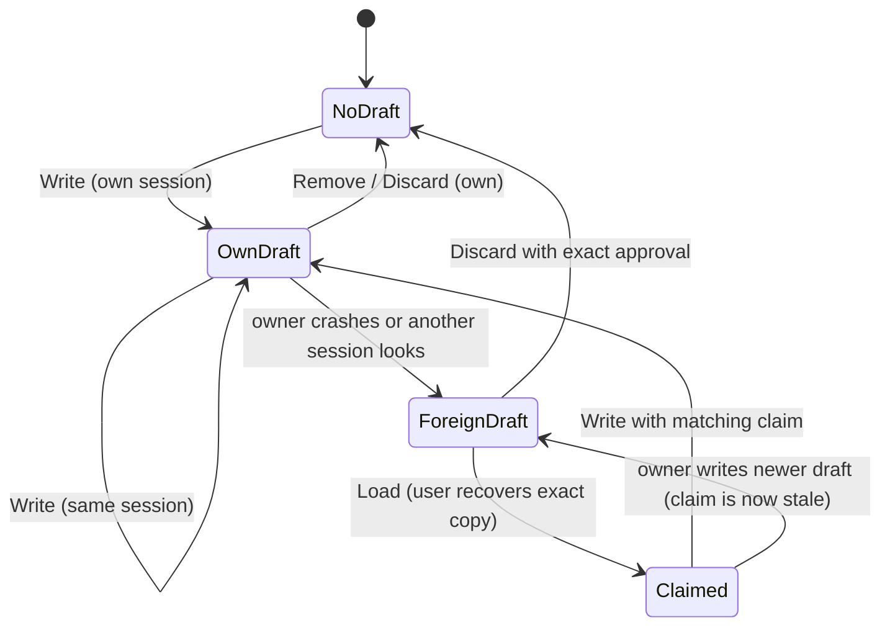

# Verify the recovery protocol

When WonderVision crashes, the unsaved edits survive as a recovery draft. A
later session, or a second window running at the same time, must never replace
or delete that draft unless its user recovered or approved discarding exactly
that draft. Breaking this loses the only copy of someone's unsaved work.

When a crash interrupts a draft write, it leaves a `.recovery-*` temp file.
`List` removes those, but it must never remove the temp file of a write that is
still in progress, or that write fails.

## Run

```sh
python3 scripts/verify_recovery_model.py
```

It takes about 20 seconds. It needs Go 1.27.3 and Java 11 or newer, and it
downloads the checksum-pinned TLC 1.8.0 jar to `build/tools/` once (the same jar
as `scripts/verify_save_model.py`). Output goes to
`build/verification/recovery-model/`, with `summary.txt` and one log per check.
CI runs it in the `checks` job of `.github/workflows/verify.yml`.

A pass prints:

```text
code-baseline: internal/documents tests pass
model-baseline: ... 521104 distinct states found, 0 states left on queue.
model-lock: counterexample found for NoUnreviewedLoss
code-lock: TestConcurrentSessionRecoveryWrites rejects it
model-claim: counterexample found for NoUnreviewedLoss
code-claim: TestStaleRecoveryClaimCannotReplaceNewerDraft rejects it
model-discard: counterexample found for NoUnreviewedLoss
code-discard: TestPreviousSessionDraftRequiresReview rejects it
model-cleanup: counterexample found for NoLiveTempDeleted
code-cleanup: TestListRemovesOnlyOrphanedRecoveryTemps rejects it
VERIFIED: ...
```

The script does four things:
1. It runs the `internal/documents` tests on the unmodified code. A real break in the working tree fails here, naming the test and what it saw.
2. It model-checks `verification/recovery/Recovery.tla` and requires all four invariants to hold.
3. It turns on each `Broken*` flag in turn and requires a counterexample for the invariant that mutant targets (`MUTANTS` in the script), which shows the property can fail. Only that invariant is checked for a mutant, because TLC reports the first violation it reaches.
4. It applies the matching edit to the real `internal/documents/recovery.go` through `go test -overlay` and requires the named Go test to fail. The working tree is never modified.

## What is verified

**Properties:**
- `NoUnreviewedLoss`: a session replaces or deletes a draft owned by another session only if its user recovered that exact draft (`Load` set the claim) or approved discarding that exact draft.
- `NoLiveTempDeleted`: `List` only removes temp files left by writers that crashed.
- `LockedCommit` and `OrphansCleanable`: only the lock holder is ever mid-operation, so a temp file seen while the lock is free is always an orphan.

**Scope:**
- two sessions;
- one file path, since drafts for different paths use different files and don't interact;
- up to 15 steps, including crashes at any point;
- every interleaving within those limits.

**Assumptions:**
- `flock` excludes other processes and is released when a process dies.
- `root.Rename` replaces the draft atomically.
- `Load` reads one open file, so it sees either the old draft or the new one.

**Not covered:**
- `List`'s clean-up of sensitive drafts and drafts identical to their saved base. It is content-neutral, and the guardrail in `internal/guardrails/recovery_sensitive_test.go` covers the sensitive-path rule.
- Disk errors, damaged headers and the 20 MiB limit (covered by `TestRecoveryRetainsExternalConflictAndRejectsDamage`).
- More than two concurrent sessions.



Each write goes lock → header check → temp file → rename → unlock. A crash
after the temp file is created leaves an orphan, which the next `List` that
gets the lock removes.

## Coverage record

The sync commit is the last commit that changed `verification/recovery/` or this
skill. It is computed rather than written down, so it survives rebase and squash
merges:

```sh
git log -1 --format=%H -- verification/recovery .agents/skills/verify-recovery-protocol
```

Last confirmed: 2026-11-06, when the temp-file cleanup was added.

| Model action | Code |
|---|---|
| `BeginWrite` | `internal/documents/recovery.go: RecoveryStore.Write`, `recoveryLock` and the header check |
| `WriteTemp` | `Write`: `root.OpenFile(recoveryTempPrefix + ...)` and the body |
| `CommitWrite` | `Write`: `root.Rename(temp, name)`, then unlock |
| `WriteFail` | an error after the check: the deferred `root.Remove(temp)`, then unlock |
| `WriteAllowed` | the `previous.Session != store.session && (plan.claim == nil \|\| ... previous != *plan.claim)` check in `Write` |
| `BeginDiscard` / `BeginRemove` / `CommitRemove` | `RecoveryStore.Discard`, `RecoveryStore.Remove` → `remove`, including its `approved` check |
| `List` | `RecoveryStore.List` (records shown to the user) |
| `CleanTemps` | `List` with the lock held (`lock != nil`): removes `recoveryTempPrefix` files |
| `Load`, `claim` | `RecoveryStore.Load` (`r != record` check) and `Document.recoveryClaim` |
| `Crash`, `gen` | process death; `NewRecoveryStore` gives each process a new `session` |
| `lock` | `internal/documents/recovery_lock.go: recoveryLock` |

The app layer is not modeled. `internal/app/recovery.go` (`writeRecovery`,
`removeRecoveryPath`) and the recovery review UI only call these functions.

To check for drift:

```sh
git diff --stat $(git log -1 --format=%H -- verification/recovery .agents/skills/verify-recovery-protocol)..HEAD -- internal/documents/recovery.go internal/documents/recovery_lock.go internal/documents/recovery_lock_*.go
```

Empty output means the covered code hasn't changed since the model was last
confirmed.

## Interpret results

- **`code-baseline` fails:** the current code breaks a recovery test. Read the failing test's message; `TestStaleRecoveryClaimCannotReplaceNewerDraft`, `TestPreviousSessionDraftRequiresReview` and `TestConcurrentSessionRecoveryWrites` each describe a lost-draft scenario in plain words.
- **Model baseline fails with `NoUnreviewedLoss`:** read the trace in `model-baseline.txt` and retell it as numbered steps in the code's words. For example:
  1. Session s1 (`<<"s1", 0>>`) passes `Write`'s header check.
  2. Session s2 passes its own check.
  3. s1 renames its draft into place.
  4. s2 renames over it.

  Then check each step against the coverage table. If a step is one indivisible operation in the model but not in the code, the model is wrong; if the code allows it, it's a real bug. Report real bugs with the steps, and don't change product code unless the user asks.
- **Model baseline fails with `NoLiveTempDeleted`:** cleanup removed a temp file whose writer was still between `WriteTemp` and `CommitWrite`. Check whether some writer can hold a temp file without the lock, or whether cleanup ran without it.
- **Model baseline fails with "Deadlock":** a guard stopped every action before the step bound. That is a modeling error; `Done` should always be enabled at the bound.
- **A model mutant no longer fails:** the model lost the ability to express that bug. Fix the model before trusting a pass.
- **A code mutant step stops with "changed where the … mutant applies":** `recovery.go` changed under that mutant. Update the `MUTANTS` table in `scripts/verify_recovery_model.py` to the new code, and update the model if the protocol changed.
- **A code mutant isn't rejected:** the Go tests no longer catch that bug. Add or fix the test named in `MUTANTS`; never remove the mutant.

## Maintain

- When the protocol changes on purpose, change `Recovery.tla` to match the code, keep the coverage table in step, and rerun.
- Never weaken `NoUnreviewedLoss`, lower `MaxSteps`, or drop a mutant without the user's explicit approval.
- When the covered code changes but the model still describes it, rerun, then update "Last confirmed" above in the same change. That moves the sync commit forward.
- When you add steps to an operation, raise `MaxSteps` so every earlier behaviour is still reachable. Otherwise a mutant can stop failing because its counterexample got longer, not because the code got safer.
- For the empirical lock and lifetime regressions, run `python3 scripts/verify_recovery.py`.
- For the save protocol, use `verify-save-protocol`.
