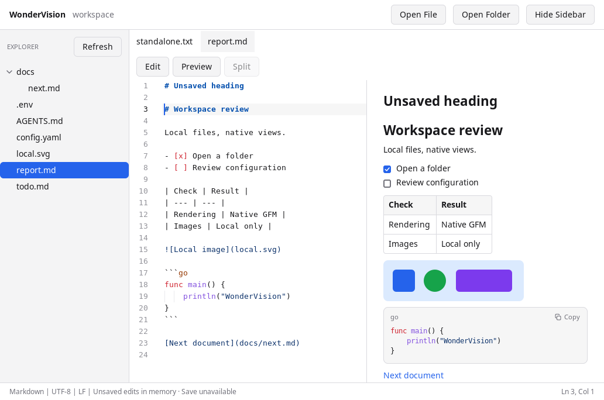

# WonderVision

A native, single-window Go text workspace using MyGo. This repository implements
M0–M4 of [the specification](spec.md). Changes are listed in
[CHANGELOG.md](CHANGELOG.md).

## Build and run

Use **Go 1.27.3** and the pinned **MyGo v0.7.4**. On Linux the native application
requires GTK 3 and a desktop display; WebKitGTK is not needed.

```sh
go test ./...
go build -tags mygo_noinspector -trimpath -o build/wondervision ./cmd/wondervision
./build/wondervision
```

The native MyGo template was initialized with the v0.7.4 CLI. Its entry point is
under `cmd/wondervision`. No frontend, local server, or runtime network client is
used.

## Package

`go tool mygo build` builds production packages from `mygo.json` into `build/`:

```sh
go tool mygo build -platform linux/amd64,linux/arm64,windows/amd64 -skip-installer
```

- **Linux:**
  - `wondervision_<version>_<arch>.deb`: installs to `/opt/wondervision`, links `/usr/bin/wondervision` and adds a menu entry. It depends on GTK 3 only; `mygo.json` sets `linux.webview: false` because the app shows no web pages.
  - `wondervision-<version>-linux-<arch>.tar.gz` with `install.sh`: run `sh install.sh` as your user (not root) to install into `~/.local`, and `sh install.sh --uninstall` to remove it. Settings and recovery data are kept.
  - A `PKGBUILD` for Arch Linux (`makepkg -si`).
- **Windows:** `WonderVision.exe`; drop `-skip-installer` to also get an NSIS installer.
- **macOS:** `-platform darwin/universal` makes a signed `.app` and `.dmg`, but only on a Mac.

Releases: pushing a tag `v<version>` (matching `mygo.json`) runs
`.github/workflows/release.yml`, which tests, builds the Linux packages with
`SHA256SUMS`, and drafts a GitHub release with the notes from this version's
`CHANGELOG.md` section. Running the workflow by hand builds the same files and
an ad-hoc-signed macOS disk image as artifacts, without a release.

Checked on Linux amd64: the `.deb` installs, and the installed binary opens a usable window and contains no test automation. The tarball installs and uninstalls for a regular user with the same binary. The Windows and macOS packages haven't been run.

## Platforms

| Platform | Status |
| --- | --- |
| Linux amd64 | Built, tested and driven end to end (CI and local), packaged |
| Linux arm64 | Built, vetted and packaged; not run |
| macOS amd64/arm64 | Built in CI, and the Go tests (headless) pass on macOS 15 arm64; the native window has not been checked yet: see [docs/MACOS-TESTING.md](docs/MACOS-TESTING.md). Recovery locks use `flock` and rename/move uses `renameatx_np(RENAME_EXCL)` |
| Windows amd64/arm64 | Built and vetted in CI; never run. Crash recovery fails closed (no tested process lock) and rename/move reports "unsupported" |

## Formats and limits

- UTF-8 text only. Files with invalid UTF-8 or NUL bytes are refused on open, and skipped by workspace search.
- Files over 20 MiB are refused; Markdown over 2 MiB opens in Edit and needs an explicit preview.
- Saves keep LF or CRLF line endings, a UTF-8 BOM, the final newline and the file mode. They can't keep every ACL, owner, hard link or filesystem attribute.
- Markdown preview renders GFM natively, with local images and links only. Remote images are never loaded and scripts never run.
- `.env`, keys, certificates and credential/secret file names never get recovery copies.
- In the editor's find bar, Replace All is the button only: MyGo's Ctrl/Cmd+Enter shortcut for it never reaches the field.
- Quick Open and search skip `.git`, `node_modules`, `.venv`, `vendor`, `dist`, `build`, `.next`, `target` and `__pycache__`, and never follow directory symlinks.

## Milestones

- M0: native shell, system light/dark theme, dismissible errors, idle-frame test.
- M1: native Open File/Open Folder, lazy virtualized Explorer, retained tabs,
  highlighted text/code editor, live Markdown Preview/Edit/Split with local
  images and links, and lazy restoration of the workspace and active file.
- M2: manual Save/Save As, dirty tabs and protected close/quit, fingerprinted
  atomic saves, scoped external-change watches, explicit conflict resolution,
  private recovery for non-sensitive drafts, and workspace file actions.
- M3: command palette (Ctrl/Cmd+Shift+P), Quick Open (Ctrl/Cmd+P) with an
  on-demand cancellable scan and recent files, and workspace search
  (Ctrl/Cmd+Shift+F) with streamed results that open at the matching line.
  One command table drives shortcuts, the File menu, toolbar and palette. See
  [the M3 design](docs/M3-DESIGN.md).

Edits stay in memory until Save. Recovery copies follow non-sensitive edits after
15 seconds of quiescence and are reviewed after a crash; `.env`, keys, certificates,
and credential/secret filenames have recovery disabled. Files over 20 MiB
are refused; Markdown over 2 MiB starts in Edit and requires an explicit preview
action. Only UTF-8 text is supported. The Linux desktop was exercised. macOS and
Windows (amd64 and arm64) are compiled and vetted in CI but have never been run;
recovery locking fails closed on Windows, and rename/move is Linux-only.

Preferences contain paths and UI choices in the OS config directory under
`wondervision/preferences.json`. Private recovery copies live under the OS cache
directory in `wondervision/recovery`; document contents never enter preferences.
No app metadata or index is placed inside the workspace.

Workspace actions are under **File**. Rename/move keep open buffers and prevent
destination replacement; their exclusive adapter currently supports Linux amd64
and arm64. Other platforms report an unsupported operation. Deletion is explicitly
permanent and confirmed: MyGo's path-based Trash API does not provide the rooted
filesystem boundary used here. Save preserves supported LF/CRLF, BOM, final
newline and mode bits. Atomic replacement cannot preserve every ACL, ownership,
hard-link relationship or filesystem property. An outside write can race the final
check and rename; known conflicts block an unconfirmed save.

Recovery uses nonblocking process locks on Linux/BSD/macOS (tested on Linux).
It fails closed on Windows and other targets until an adapter is verified.
If another session holds the lock, an error preserves the existing copy; another
edit retries recovery. This adds no idle polling.

## Verification

```sh
go test -race ./...
go vet ./...
go tool mygo vet
go build -tags e2e -o build/wondervision-e2e ./cmd/wondervision
python3 scripts/verify_native.py run --out build/verification/native-run
python3 scripts/verify_editing.py --out build/verification/editing-run
python3 scripts/verify_m3.py --out build/verification/m3-run
python3 scripts/verify_request_order.py --mutation-check
python3 scripts/verify_save_model.py
python3 scripts/verify_recovery.py
python3 scripts/verify_recovery_model.py
```

The native driver needs an authorized X11 desktop, Python 3, libX11, libXtst,
libatspi, `xwininfo`, and `xprop`. The `e2e` tag adds a private test-only Unix
socket. It is excluded from production. Only one driver should use a desktop at
a time. All test workspaces and preferences are isolated.

The save-model helper additionally needs Java 11+ and downloads a checksum-pinned
development-only TLC jar. The application gains no runtime dependency.

To measure the spec §9 performance contract (about 25 minutes; ImageMagick's
`import` is used for screenshots):

```sh
go build -tags mygo_noinspector -trimpath -o build/wondervision ./cmd/wondervision
python3 scripts/measure_performance.py --out build/verification/performance
```

It runs the production binary for launch time and 10-minute idle CPU, memory
and network (foreground and minimized), and the e2e binary for Quick Open
latency on 1,000 and 10,000 files and typing in the 100 KiB file. Results are
in `PERFORMANCE.md`; CI runs it on demand (`workflow_dispatch` with `performance` ticked).

Project-local verification skills live in `.agents/skills/` (linked from
`.claude/skills/` for Claude Code). CI (`.github/workflows/verify.yml`) runs
the Linux checks on a pull request that changes code, and again when it merges
to `work`. The macOS tests and the other-OS builds run on that merge, on a
manual run, and on a pull request that changes platform-specific code. A
docs-only change does not start a run. See
[the M2 workflow](docs/M2-WORKFLOW.md), [M2 evidence](docs/verification/M2.md),
[observed performance](PERFORMANCE.md), and
[the spec §13 checklist traced to its evidence](docs/ACCEPTANCE.md). Bounded request-order tests cover
143 schedules and reject two deliberately broken guard variants; they are not an
unbounded formal proof. A separate finite TLA+ save model and three real-code
mutations check save/edit/conflict ordering. The final filesystem race is an
explicitly reproduced limit. The 10-minute and 24-hour release gates remain M4.


